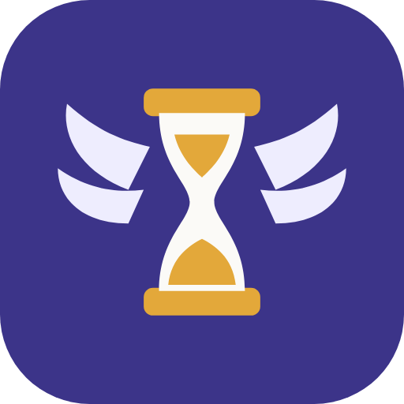
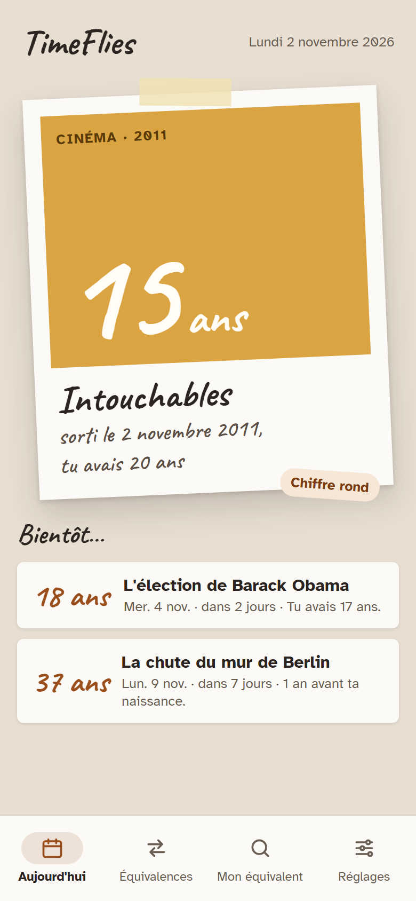
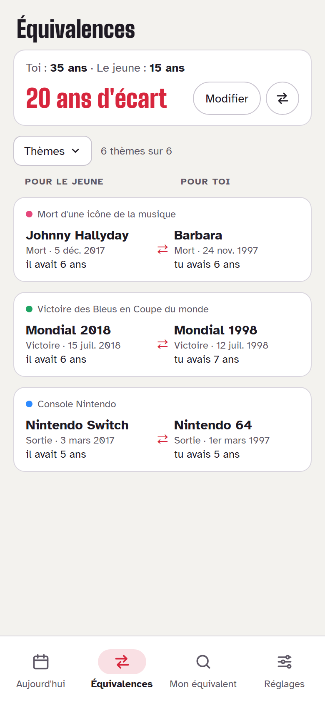

# TimeFlies

> « Pour un gars qui a 15 piges aujourd'hui, Friends, c'est exactement ce que Happy Days était pour nous. »
> Inspiré de l'épisode *Bloqués #108 - On est les vieux des jeunes*.

TimeFlies est une application **Android et Windows** qui donne des coups de vieux :

- **Le coup de vieux du jour** : « Ça fait 15 ans qu'*Intouchables* est sorti. Tu avais 20 ans. » Sur Android, il s'affiche dans un widget de l'écran d'accueil ; sur Windows, dans une icône de la barre des tâches avec une notification le matin.
- **Les équivalences** : selon ton âge et celui d'un jeune, les événements qui ont la même place dans vos deux vies (Friends ↔ Happy Days, la mort de Tupac ↔ la mort d'Elvis, Zidane ↔ Platini…).
- **Quel âge ?** : choisis un événement et vois quel âge vous aviez tous les deux à cette date (« −14 ans » si l'autre n'était pas encore né).

 

Aucun compte, aucune donnée personnelle envoyée : les événements sont intégrés à l'application et tes réglages restent sur ton appareil. La seule connexion cherche une nouvelle version sur GitHub, une fois par jour au plus ; elle se désactive dans Réglages.

## État

Aucune version n'est encore publiée. Les spécifications sont dans [`docs/`](docs/), les maquettes dans [`docs/maquettes/`](docs/maquettes/README.md), et la suite dans la [feuille de route](docs/ROADMAP.md).

## Installation

Chaque version est publiée dans l'onglet [**Releases**](https://github.com/Fugeekies/TimeFlies/releases) avec deux fichiers :

- **Android** (8.0 et plus) : télécharge `TimeFlies-X.Y.Z.apk` depuis le téléphone et ouvre-le. Android demande d'autoriser l'installation d'applications depuis ton navigateur : c'est normal pour une application qui ne passe pas par le Play Store.
- **Windows** (10 et 11, 64 bits) : télécharge et lance `TimeFlies-X.Y.Z-Setup.exe`. L'installeur n'est pas signé par un éditeur reconnu : si Windows affiche « Windows a protégé votre ordinateur », clique sur **Informations complémentaires** puis **Exécuter quand même**. TimeFlies s'installe pour ton compte, sans droits administrateur.

Pour mettre à jour, installe la nouvelle version par-dessus l'ancienne : tes réglages sont gardés.

## Technique

Kotlin et Compose Multiplatform : un seul code pour Android et Windows. Les versions publiées seront compilées par GitHub Actions.

## Licence

[GNU GPL v3](LICENSE).

Polices embarquées sous licence SIL Open Font License 1.1 : [Caveat](licenses/OFL-Caveat.txt), [Atkinson Hyperlegible](licenses/OFL-AtkinsonHyperlegible.txt), [Bungee](licenses/OFL-Bungee.txt), [VT323](licenses/OFL-VT323.txt) et [Big Shoulders Display](licenses/OFL-BigShouldersDisplay.txt) ; sous licence Apache 2.0 : [Permanent Marker](licenses/Apache-2.0-PermanentMarker.txt).
