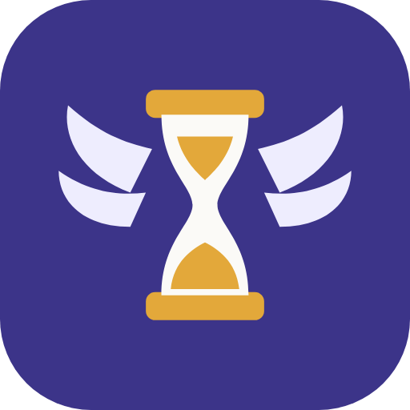

# Spécification visuelle & design UI - TimeFlies

> Document de conception écrit avant le code (13/11/2026). L'ordre des styles est décidé (Polaroïd en V1, puis VHS au jalon 14, décision du 17/11/2026, puis Éphéméride au jalon 15) ; les détails et les règles d'ergonomie restent des propositions **à valider** tant qu'ils ne sont pas cochés dans la feuille de route.

Ce document définit l'identité visuelle, la charte graphique et l'ergonomie de **TimeFlies**, sur Android et sur Windows. Les maquettes et les règles de chaque écran sont dans `UISpec/`.

---

## 🎨 Identité & charte graphique

### 1. Styles d'affichage (décisions du 13/11/2026)
Trois styles sont prévus. Chaque style a son propre jeu de jetons (couleurs, polices, ornements) ; la mise en page des écrans, elle, est la même dans tous. Maquettes : [`maquettes/`](maquettes/README.md).

| Style | Version | Pourquoi |
|---|---|---|
| **Polaroïd** | **V1**, seul style livré (décision du 13/11/2026, qui remplace celle donnant l'Éphéméride en V1) | Le plus beau pour la feuille du jour ; les âges écrits à la main sur les bandeaux. |
| **Éphéméride** | Jalon 15, après le VHS | Le plus clair pour les menus et les listes. |
| **VHS** | Jalon 14, avancé avant l'Éphéméride (décision du 17/11/2026) | L'ambiance cassette des années 80-90, comme sur la maquette. |

Depuis le VHS (jalon 14), l'utilisateur choisit dans **Réglages › Affichage** (Polaroïd par défaut), et le style s'applique aussitôt à toute l'application et au widget. Chaque style est un jeu de jetons (`StyleTokens`, `ColorScheme`) : l'ajout de l'Éphéméride (jalon 15) n'a pas touché à la mise en page des écrans.

Les maquettes des écrans autres qu'Aujourd'hui sont dessinées en Éphéméride (`maquettes/`) : leur **mise en page** vaut pour la V1, mais leurs couleurs et leurs polices sont celles du Polaroïd (voir plus bas). Elles ne seront pas redessinées avant le code (décision du 13/11/2026).

#### Éphéméride (jalon 15)
Le coup de vieux du jour est une page d'**éphéméride**, ce calendrier dont on arrache une feuille chaque matin : un grand chiffre rouge, le jour en dessous, du papier. L'écran Aujourd'hui et le widget reprennent cette feuille ; le reste de l'application reste sobre pour la laisser au premier plan.

- Le **grand chiffre** n'est pas le jour du mois mais le **nombre d'années** écoulées (« 15 ans »), en rouge éphéméride.
- Haut de la feuille : deux petits anneaux de reliure et une ligne de perforation (pointillés) ; c'est le seul ornement de l'application.
- Le reste (listes, réglages) utilise des cartes simples, sans perforation.
- Palette et polices : § 2 et § 5 ci-dessous.

#### VHS (jalon 14, comme sur la maquette, décision du 17/11/2026)
La feuille du jour devient une **cassette VHS** ([`maquettes/android/TodayVhs.png`](maquettes/android/TodayVhs.png)) : en haut « ● REC » en rouge et le compteur de bande en cyan (le nombre d'années en minutes, `00:15:00`), les deux bobines, puis l'**étiquette blanche collée de travers** (−1,5°) avec de légères lignes de balayage, sur l'étiquette seulement. L'étiquette porte le jour (« LUNDI 2 NOVEMBRE 2026 · SP »), le nombre d'années en grand (« 15 ANS », magenta), le titre écrit au feutre, la légende, « Tu avais 20 ans. » et la puce « CHIFFRE ROND » jaune sur fond d'encre.

Règles du style VHS dans toute l'application :
- **Toujours sombre** (les règles communes le permettent) : le style ignore le thème clair du système et le thème forcé du panneau de débogage ; sur Android, les icônes des barres système passent en clair.
- En-tête d'Aujourd'hui : « TIMEFLIES » en magenta et « ▶ PLAY » en jaune ; la date est sur l'étiquette.
- Nombres d'années, écarts et titres d'écran en **Bungee** (environ 0,72 fois la taille du Caveat, pour la même place) ; titres de section en **VT323** cyan, en capitales, précédés de « » » (« » BIENTÔT… ») ; titre de l'étiquette en **Permanent Marker**.
- Cartes des listes : fond `#1B1824`, bordure fine `#2E2940`, coins de 10 dp, sans ombre.
- Les ornements (« ● REC », « ▶ PLAY », chevrons) ne sont pas lus par TalkBack et le Narrateur.

#### Polaroïd (V1, maquette validée le 13/11/2026)
La feuille du jour devient un **Polaroïd** : cadre blanc cassé (`#FBFAF7`, comme sur la maquette) avec bande épaisse en bas, où le titre et la légende (« sorti le 2 novembre 2011, tu avais 20 ans ») sont écrits à la main ; à la place de la photo, un aplat de la couleur de la famille de l'événement, légèrement passé, qui porte le nombre d'années en grand et en blanc. La photo est inclinée, un ruban adhésif la tient en haut. Ambiance claire et chaude.

Règles du style Polaroïd dans toute l'application :
- **Écriture manuscrite** (`Caveat`) pour le nombre d'années partout où il apparaît : la photo du jour, et le **bandeau de gauche des cartes** des listes (« 18 ans », « 37 ans »), en accent. Aussi pour le titre de la photo, sa légende et les titres de section (« Bientôt… »).
- **Texte lisible** (`Atkinson Hyperlegible`) pour tout le reste : titres et détails des cartes, menus, réglages, boutons. Les menus restent aussi clairs qu'en Éphéméride.
- Cartes des listes : fond blanc cassé, coins de 6 px, ombre légère, sans bordure.

Jetons de la maquette (clair) : fond `#E8DFD2`, cartes `#FBFAF7`, encre `#2B2420`, texte secondaire `#6A5D52`, accent `#9A4E1C`. Version sombre « chambre noire » et contrastes vérifiés au jalon 9 (décision du 15/11/2026, § 2 et « Accessibilité »). Le Polaroïd reste un tirage clair dans les deux thèmes : son cadre et sa photo gardent leurs couleurs, l'encre manuscrite reste foncée.

##### Le cadre et la photo (décision du 17/11/2026, qui remplace celle du 14/11/2026)

- **Le cadre** est blanc cassé pour tous les événements, comme sur la maquette. Les cadres de la couleur de la décennie et le chiffre de la décennie écrit dans le coin (décision du 14/11/2026) sont abandonnés : ce n'était pas beau.
- **La photo** garde la couleur de la famille, avec en filigrane (blanc à 42 %), en haut à droite, **un dessin au trait par type** : pop-corn (blockbuster), crayon et étincelle (film d'animation), masques de théâtre (comédie française), planète et étoiles (épisode de saga). Un type sans dessin prend celui de sa famille : clap, télévision, vinyle, ballon, manette, monument. Les dessins des autres types arrivent avec leurs données. Types de sport ajoutés le 18/11/2026 : couronne de laurier autour d'une étoile (titre mondial), raquette et balle (Grand Chelem), vélo de course (Tour de France).
- Tout est dessiné par l'application (vectoriel) : aucune image, aucun droit, aucun poids ajouté.

#### Règles communes aux trois styles
- Contraste AA dans les trois, en clair et en sombre (VHS peut ne proposer que le sombre).
- Les couleurs des familles (§ 3) et la puce « Chiffre rond » (§ 4) gardent leur sens dans les trois styles.
- Aucune image photographique d'une œuvre réelle (affiche, pochette) : les styles n'utilisent que des formes dessinées et du texte.

### 2. Palettes (clair et sombre)
L'application suit le thème du système (clair ou sombre). Toutes les couleurs sont des jetons du thème Compose (`ColorScheme` Material 3 personnalisé), un jeu par style, jamais des couleurs écrites en dur dans un écran.

#### Polaroïd (V1)

| Jeton | Clair | Sombre | Usage |
|---|---|---|---|
| `background` | `#E8DFD2` papier kraft | `#1C1714` brun nuit | fond des écrans |
| `surface` | `#FBFAF7` blanc cassé | `#2A231F` | cartes (le cadre de la photo reste blanc cassé dans les deux thèmes) |
| `onSurface` | `#2B2420` encre | `#F1E8DD` crème | texte principal |
| `onSurfaceVariant` | `#6A5D52` | `#BFAF9F` | libellés, dates, textes secondaires |
| `primary` | `#9A4E1C` brun cuivré | `#E39A62` cuivre clair | âges manuscrits, onglet actif, boutons principaux |
| `outline` | `#D6CBBC` | `#4A3F37` | séparateurs |
| `secondaryContainer` | `#F1E1D3` | `#4A3426` | onglet actif, pastille « Chiffre rond » |
| silhouettes des personnes (toi, puis les 3 âges ajoutés, décision du 17/11/2026) | `#B4501E` rouille, `#0E7C7B` bleu canard, `#7A4A9E` prune, `#4F6B12` olive | `#F08A55`, `#4FC3C0`, `#C3A3F0`, `#B5D168` | « Quel âge ? », Équivalences |

Palette sombre « chambre noire » : décision du 15/11/2026. L'application suit le thème du système ; sur Android, la fenêtre prend aussi le fond du thème avant la première image (`values-night/themes.xml`).

La photo du jour prend la couleur de la famille de l'événement (§ 3), légèrement passée.

#### VHS (jalon 14, sombre seulement)

Couleurs de la maquette ([`maquettes/android/TodayVhs.html`](maquettes/android/TodayVhs.html)), vérifiées par `ContrastTest`.

| Jeton | Sombre | Usage |
|---|---|---|
| `background` | `#0E0B16` nuit violette | fond des écrans |
| `surface` | `#1B1824` | coque de la cassette, cartes |
| `surfaceContainer` | `#151220` | barre de navigation |
| `onSurface` | `#F2ECFF` | texte principal |
| `onSurfaceVariant` | `#B9B0CC` | libellés, dates, textes secondaires |
| `primary` | `#FF3EA5` magenta | nombres d'années, nom de l'application, onglet actif, boutons principaux |
| `outline` | `#2E2940` | bordures des cartes, bobines |
| `secondaryContainer` | `#3E1533` (magenta à 20 %) | onglet actif, pastille « Chiffre rond » |
| silhouettes des personnes (toi, puis les 3 âges ajoutés) | `#FFE14D` jaune, `#3EE6FF` cyan, `#7CFF8A` vert, `#FF9F43` orange | « Quel âge ? », Équivalences |
| ornements | `#FF4D4D` « ● REC », `#3EE6FF` compteur et titres de section, `#FFE14D` « ▶ PLAY » | |
| étiquette | papier `#F4F1E8`, encre `#16121F`, date `#6B5F7A`, légende `#4A4158`, grand nombre `#E0177F` | |

#### Éphéméride (jalon 15, clair et sombre selon le système)

| Jeton | Clair | Sombre | Usage |
|---|---|---|---|
| `background` | `#F3F2EE` papier gris chaud | `#16141A` | fond des écrans |
| `surface` | `#FFFFFF` | `#221F27` | cartes, feuille d'éphéméride |
| `onSurface` | `#1F1B24` encre | `#EDEAF2` | texte principal |
| `onSurfaceVariant` | `#5E5866` | `#A8A1B2` | libellés, dates, textes secondaires |
| `primary` | `#D3243B` rouge éphéméride (`#D7263D` sur la maquette, assombri d'un cran pour lire à 4,5:1 sur le fond, 4,42:1 avant) | `#FF5C6C` | grand chiffre, onglet actif, boutons principaux |
| `secondaryContainer` | `#F9E1E4` (rouge à 14 %) | `#45222A` (rouge à 20 %) | onglet actif, puce « Chiffre rond » |
| `onSecondaryContainer` | `#B01F33` | `#EDEAF2` | texte de la puce « Chiffre rond » |
| silhouettes des personnes (toi, puis les 3 âges ajoutés) | `#D3243B` rouge, `#1F6FB2` bleu, `#2E7D32` vert, `#7B4FA0` violet | `#FF5C6C`, `#6CB4FF`, `#6FD47A`, `#C9A2FF` | « Quel âge ? », Équivalences |
| anneaux de reliure | `#C9C4CF` | `#4A4452` | ornement de la feuille du jour |
| `outline` | `#D9D5DE` | `#3A3542` | bordures fines, perforation |

Contrastes vérifiés par `ContrastTest`. Sur le widget, le nombre est dessiné une fois en `#D3243B`, lisible sur la feuille claire et la feuille sombre (au moins 3:1).

### 3. Couleurs des familles d'événements
Une pastille de couleur (point de 8 dp et puce de filtre) indique la famille de chaque événement. Couleurs choisies pour rester lisibles sur les deux fonds et ne pas reprendre le rouge `primary`.

| Famille | Couleur |
|---|---|
| Séries & télé | `#7C5CFF` violet |
| Cinéma | `#E09F1F` ambre |
| Musique | `#E5487C` rose |
| Sport | `#1FA463` vert |
| Jeux vidéo & tech | `#2E8BFF` bleu |
| Politique & histoire | `#8A7F72` taupe |

### 4. Chiffres ronds
Un anniversaire rond est signalé par une puce « Chiffre rond » : fond `primary` à 12 %, texte `primary`. Multiples de 10 et de 5 ont la même puce ; l'ordre d'affichage suffit à les distinguer (voir `EVENTS_DATA.md`).

### 5. Typographies (embarquées)
Les polices sont **embarquées** dans l'application (ressources Compose, licence SIL OFL) : ni Android ni Windows ne les fournissent, et les télécharger serait une connexion réseau.

* **Interface et textes (tous les styles) :** `Atkinson Hyperlegible`, conçue pour la lisibilité, y compris aux grandes tailles de police du système.
* **Polaroïd (V1) :** `Caveat` (manuscrite) pour les nombres d'années, le titre et la légende de la photo, le nom de l'application et les titres de section. Jamais en dessous de 20 sp, pour rester lisible.
* **VHS (jalon 14) :** `Bungee` (capitales d'enseigne) pour les nombres d'années, le nom de l'application et les titres d'écran ; `VT323` (police de terminal) pour le compteur, « ● REC », « ▶ PLAY », la date de l'étiquette, la puce « CHIFFRE ROND » et les titres de section ; `Permanent Marker` (feutre) pour le titre de l'étiquette. Bungee et VT323 sous licence SIL OFL, Permanent Marker sous licence Apache 2.0 (`licenses/`).
* **Éphéméride (jalon 15) :** `Big Shoulders Display` (noire pour les chiffres, grasse pour « ans », condensée), le style des chiffres d'éphéméride, pour le grand chiffre, les nombres d'années et les titres d'écran ; les titres de section en `Atkinson Hyperlegible`, petites capitales espacées. Sous licence SIL OFL (`licenses/`).
* **Échelle (sp)** : grand chiffre 96 (téléphone) / 120 (PC) ; titre d'écran 28 ; titre d'événement 20 ; texte 16 ; libellé 13 (majuscules, espacement des lettres 0,06 em).

### 6. Nom et icône (décision du 15/11/2026)

- **Nom** affiché sous l'icône, dans la fenêtre et dans l'installeur : **TimeFlies**.
- **Icône : « le sablier ailé »**, choisie parmi douze pistes. Elle ne suit pas le style Polaroïd de l'interface : c'est un symbole, lisible en 16 px.
  - Fond violet `#3C3489`, ailes lavande `#EEEDFE`, verre blanc cassé `#FBFAF7`, montures et sable ambre `#E3A83A`.
  - **Source unique** : `assets/icon/timeflies-icon.svg` (grille 108 × 108). Les autres fichiers en sont tirés :

  | Fichier | Usage |
  |---|---|
  | `assets/icon/timeflies-icon.svg` | Dessin maître (fond en carré arrondi, dessin à l'échelle 0,82) ; favicon du futur site |
  | `assets/icon/timeflies.ico` | Windows : installeur `.msi`, raccourcis, exécutable (16, 20, 24, 32, 40, 48, 64, 128 et 256 px) |
  | `assets/icon/timeflies-256.png` | Fenêtre et barre des tâches de l'app PC (copiée au build) |
  | `assets/icon/timeflies-512.png` | README, documentation, site |
  | `src/androidApp/src/main/res/` | Icône adaptative Android : fond de couleur, premier plan à l'échelle 0,66 dans la zone sûre, couche monochrome où le verre n'est qu'un contour |

- Pour modifier l'icône : changer le SVG maître, reporter les tracés dans les deux vecteurs Android, puis régénérer les PNG et le `.ico` (rendu du SVG en 512 px, puis réduction ; méthode dans `assets/icon/README.md`).

---

## 🧭 Navigation

Quatre destinations, dans cet ordre (« Quel âge ? » avant Équivalences, décision du 17/11/2026) :

| Destination | Icône (Material Symbols) | Spécification |
|---|---|---|
| Aujourd'hui | `calendar_today` | [`Today.template.md`](UISpec/Today.template.md) |
| Quel âge ? | `search` | [`EventAges.template.md`](UISpec/EventAges.template.md) |
| Équivalences | `compare_arrows` | [`Equivalences.template.md`](UISpec/Equivalences.template.md) |
| Réglages | `settings` | [`Settings.template.md`](UISpec/Settings.template.md) |

* **Navigation adaptative** (`NavigationSuiteScaffold`) : barre en bas sous 600 dp de large (téléphone), rail à gauche au-dessus (tablette, fenêtre Windows).
* L'application s'ouvre sur **Aujourd'hui**, sauf au premier lancement ([`Onboarding.template.md`](UISpec/Onboarding.template.md)).
* Sur Windows, la fenêtre s'ouvre à 1 000 × 700 dp, taille minimale 420 × 640 ; sa taille et sa position sont mémorisées.
* Le bouton Retour d'Android revient à Aujourd'hui depuis les autres destinations, puis quitte l'application.

### Hors de l'application
* **Widget Android** : [`AndroidWidget.template.md`](UISpec/AndroidWidget.template.md).
* **Icône de barre des tâches et notification Windows** : [`WindowsTray.template.md`](UISpec/WindowsTray.template.md).

---

## 🌍 Langues et formats

* Français d'abord, interface traduite en anglais, allemand, italien et espagnol (jalon 17, décision du 17/11/2026) : tous les textes dans les ressources (`strings.xml` de Compose Multiplatform), aucun texte écrit en dur dans un écran. Les maquettes de `UISpec/` gardent les libellés français, langue de référence ; le guide d'utilisation cite les libellés de chaque langue.
* Dates longues : « 2 novembre 2011 » (« 2 November 2011 », « 2. November 2011 », « 2 novembre 2011 », « 2 de noviembre de 2011 »). Dates courtes (listes) : « 02/11/2011 » (« 02.11.2011 » en allemand).
* Âges et durées : « 1 an », « 15 ans » ; avant une naissance, un âge négatif avec un vrai signe moins : « −3 ans » (décision du 15/11/2026).
* Un texte traduit peut être plus long que le français : les mises en page ne supposent pas une largeur de texte fixe.

## ♿ Accessibilité

* Contraste AA au minimum sur les deux thèmes (texte 4,5:1, grand chiffre 3:1), vérifié par un test (`ContrastTest`, module `ui`) : jetons clairs et sombres, silhouettes, encres du cadre blanc cassé du Polaroïd. Sur la photo, le grand chiffre et l'étiquette prennent, du blanc ou de l'encre, celle qui se lit le mieux sur la couleur de la famille (jalon 9).
* Les tailles de police suivent le réglage du système ; à 200 %, les cartes passent sur plusieurs lignes au lieu de couper le texte. Seul le grand chiffre de la photo garde sa taille (il fait déjà 120 dp et la photo ne pourrait pas le contenir), le nombre d'années étant aussi lu par la description.
* Chaque carte a une description pour TalkBack et le Narrateur Windows, par exemple : « Intouchables, sortie au cinéma le 2 novembre 2011, il y a 15 ans. Tu avais 20 ans. »
* Zones tactiles de 48 dp minimum. Sur Windows, tout se fait aussi au clavier (Tab, Entrée, flèches dans les listes).
* Animations réduites quand le système le demande (photo ou feuille affichée directement, sans effet) : sur Android, échelle de durée des animations à 0 (« Supprimer les animations ») ; sur Windows, `MinAnimate = 0` dans `HKCUControl PanelDesktopWindowMetrics`, que « Afficher les animations dans Windows » désactivé met aussi à 0 (à confirmer sur un PC).
* L'écriture manuscrite n'est jamais la seule porteuse d'une information : la description TalkBack et le Narrateur lisent le texte, et les détails de chaque carte sont aussi en police lisible.

## ✨ Animation

Une seule animation marquante, à l'ouverture de l'écran Aujourd'hui, une fois par jour (pas à chaque retour sur l'écran) :
* **Polaroïd (V1)** : la photo du jour **se développe** en 1,6 s : l'aplat de couleur apparaît peu à peu sur le blanc, puis l'écriture (décision du 15/11/2026, codée au jalon 9, à juger à l'écran). Une fois par jour et par lancement de l'application.
* **VHS (jalon 14)** : le compteur de bande défile de `00:00:00` jusqu'au nombre d'années en 1,6 s, aux mêmes conditions que la photo du Polaroïd.
* **Éphéméride (jalon 15)** : la feuille de la veille (avec sa date) s'arrache vers le haut depuis la ligne de perforation, en tournant un peu et en s'effaçant, et laisse apparaître celle du jour : 0,3 s d'attente puis 1,3 s, aux mêmes conditions que la photo du Polaroïd.

Le reste se limite aux transitions standard de Material 3.

---

## Questions ouvertes

1. Le nom affiché sous l'icône reste à choisir (jalon « Nom et icône définitifs ») : les maquettes affichent « TimeFlies » en attendant.
