# Maquettes

Maquettes visuelles de TimeFlies, dessinées le 13/11/2026 à partir des spécifications de [`UISpec/`](../UISpec/). Elles montrent l'apparence visée ; en cas d'écart, ce sont les spécifications qui font foi.

- Chaque écran existe en **page HTML** (à ouvrir dans un navigateur ; les liens entre écrans fonctionnent) et en **image PNG**.
- Les polices viennent de Google Fonts : sans connexion, le navigateur affiche une police de secours. L'application, elle, embarquera ses polices.
- Exemple utilisé partout : naissance en mai 1991, jeune de 15 ans, nous sommes le lundi 2 novembre 2026. Les dates des exemples seront vérifiées lors de la saisie de la base.
- Version modifiable sur le canvas Claude : https://claude.ai/artifact/FA79nXm9tDxCgUj1mQMj6h (privé, à partager depuis son menu Partager).

## Styles d'affichage

| Polaroïd (V1) | Éphéméride (jalon suivant) | VHS (idée) |
|---|---|---|
| 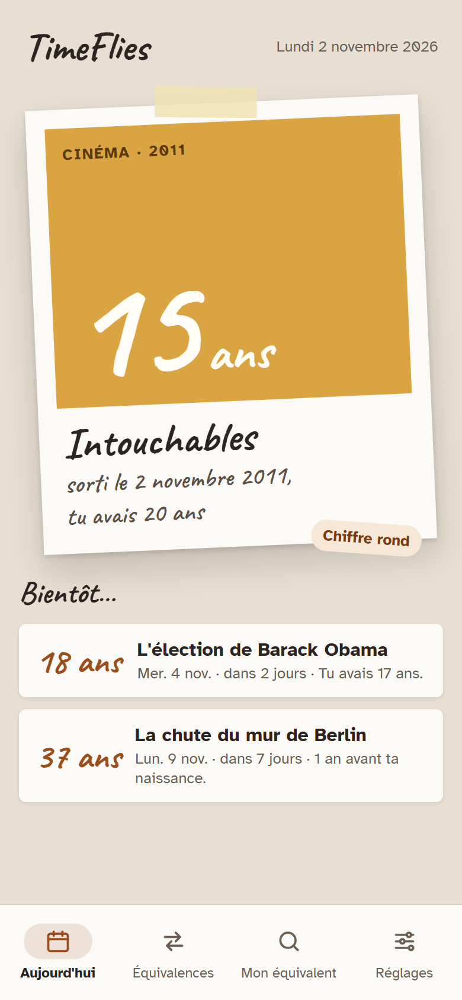 | 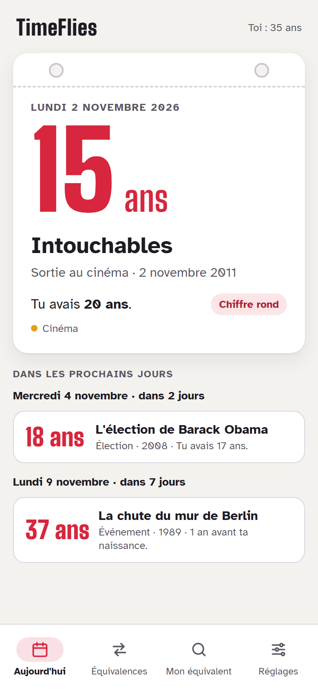 | 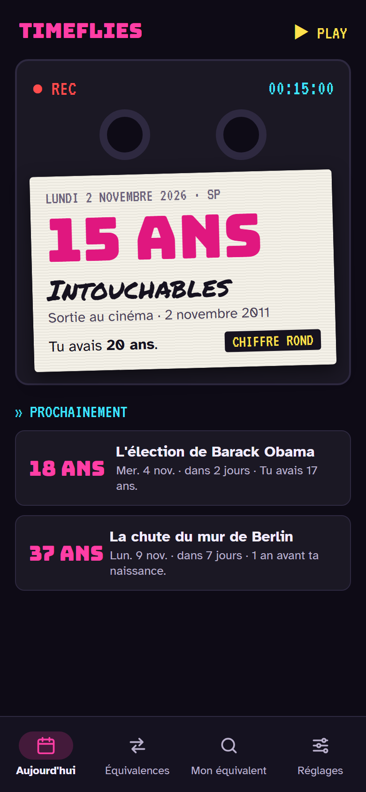 |

Décision du 13/11/2026 : la V1 n'a que le style **Polaroïd**, pour ses âges écrits à la main. L'**Éphéméride** vient juste après, le **VHS** peut-être plus tard.

### Polaroïd : le cadre de la décennie (14/11/2026)

Capture de l'application (jalon 3), qui remplace le cadre blanc de la maquette ci-dessus : le cadre prend la couleur de la décennie avec son chiffre écrit à la main, la photo garde la couleur de la famille avec le dessin du type (détails dans [`UI_DESIGN_SPEC.md`](../UI_DESIGN_SPEC.md) § 1).

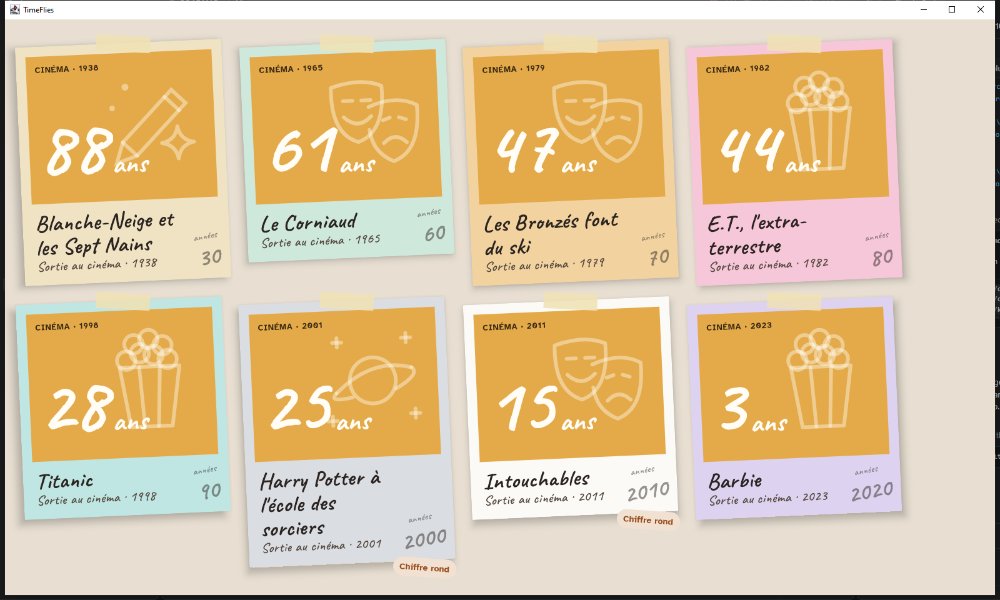

Les écrans ci-dessous sont dessinés en Éphéméride. Leur **mise en page** vaut pour la V1 ; en V1, ils prennent les couleurs du Polaroïd et ses âges manuscrits sur le bandeau de gauche des cartes (voir [`UI_DESIGN_SPEC.md`](../UI_DESIGN_SPEC.md) § 1). Ils ne seront pas redessinés avant le code.

## Android (mise en page, dessinée en Éphéméride)

| Premier lancement | Équivalences | Mon équivalent | Réglages | Widget |
|---|---|---|---|---|
| 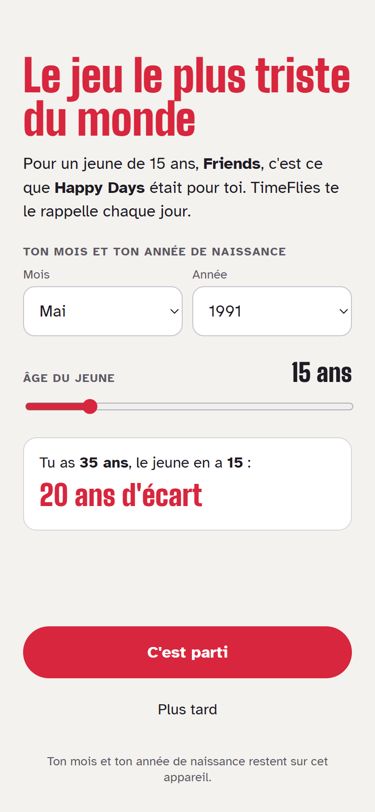 | 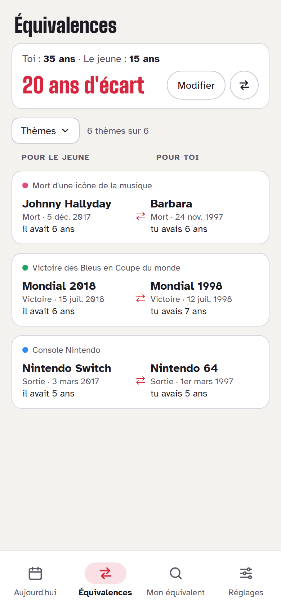 | 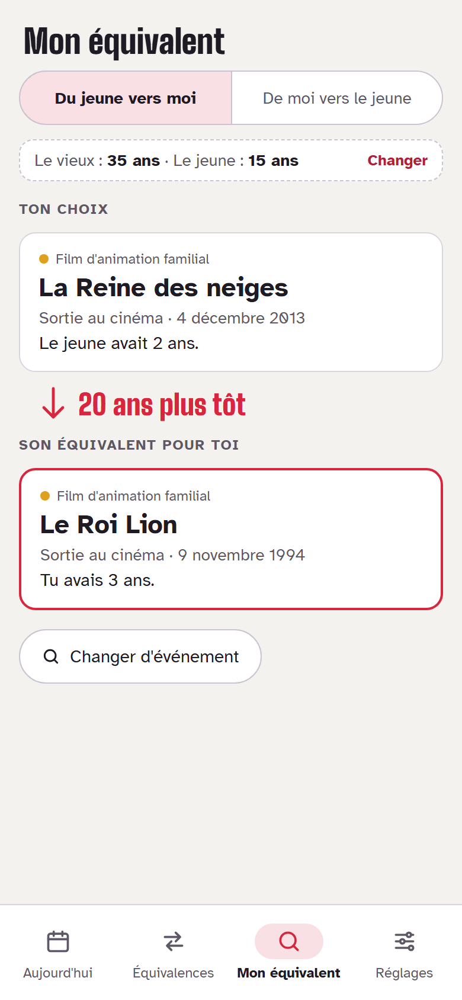 | 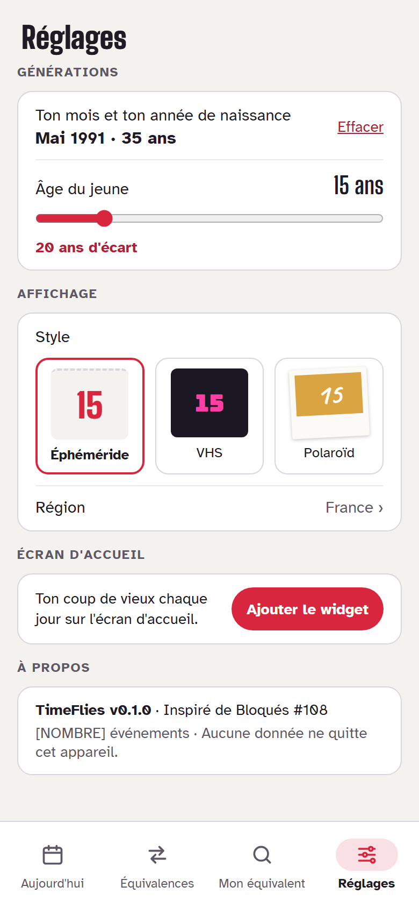 | 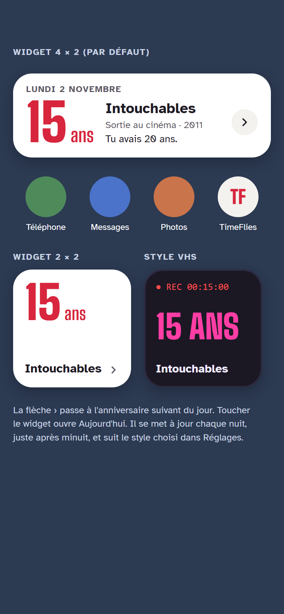 |

La maquette Réglages montre le choix des trois styles : en V1, ce choix n'apparaît pas (voir [`Settings.template.md`](../UISpec/Settings.template.md)).

## Windows (mise en page, dessinée en Éphéméride)

| Aujourd'hui | Équivalences |
|---|---|
| 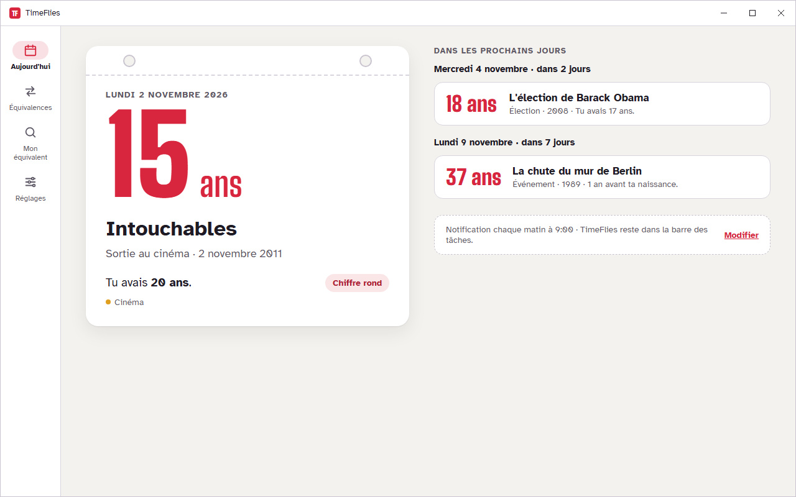 | 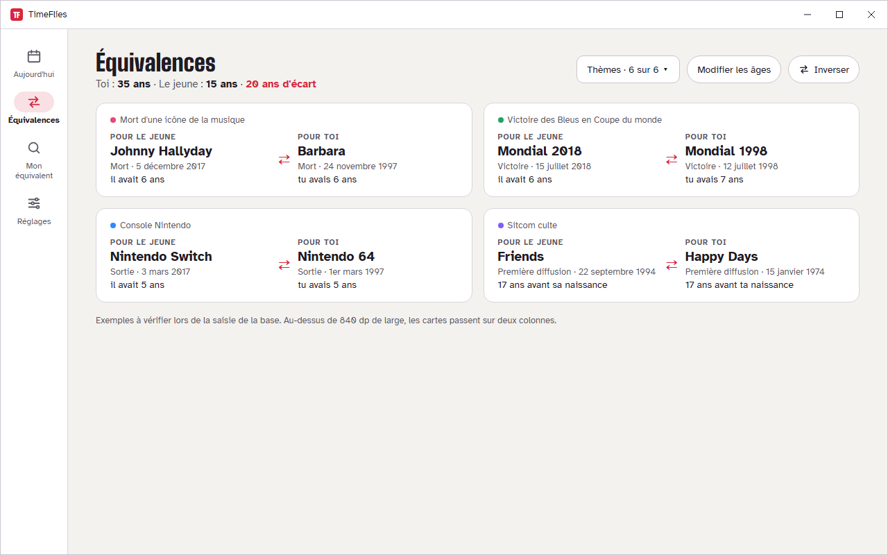 |

| Réglages | Barre des tâches et notification |
|---|---|
| 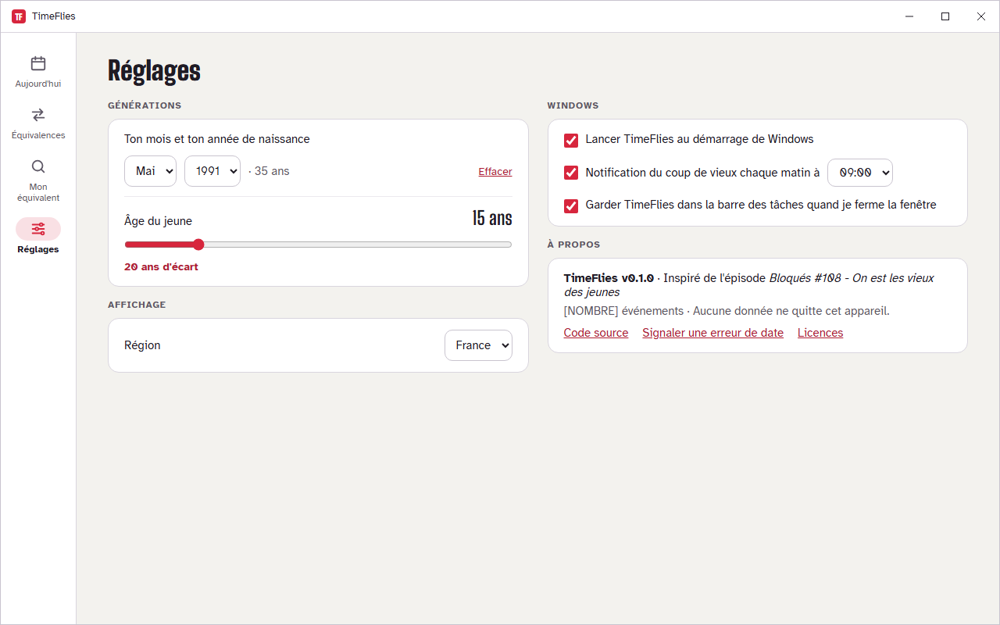 | 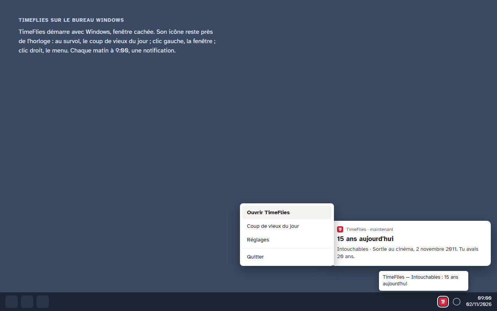 |
